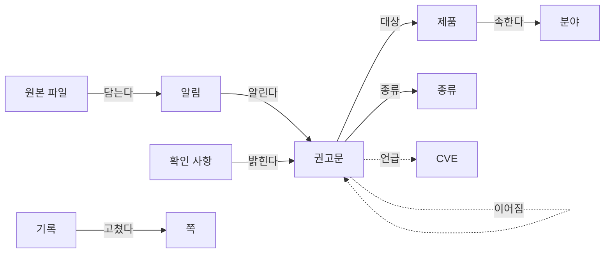

# 온톨로지

[← 목차](README.md)

이 위키가 다루는 개념, 개념 사이의 관계, 이름과 분야를 정하는 규칙이에요. 넣기와 점검을 할 때 Claude가 이 쪽을 따라요([CLAUDE.md](../../CLAUDE.md)). 개수는 2026-10-23 기준이에요.

## 한눈에 보기



실선은 모든 권고에 있는 관계이고, 점선은 있을 수도 없을 수도 있는 관계예요.

## 1. 개념

| 개념 | 뜻 | 식별자 | 속성 | 어디에 적나 | 지금 수 |
| --- | --- | --- | --- | --- | --- |
| 원본 파일 | 카카오톡 대화 내보내기 파일 | 파일 이름 | 저장한 때 | `raw/` | 1 |
| 알림 | 카톡 메시지 한 건 | `원본 파일:줄` (예: `kakaotalk-2026-10-23.txt:991`) | 받은 날짜·시각, 제목 원문 | 원본 그대로 | 117 |
| 권고문 | 금보원 홈페이지의 보안권고문 게시물 하나 | 권고 ID `A-YYYYMMDD-HHMM` (예: `A-20261023-0943`) | 제목, 종류, 제품, CVE | [timeline.md](timeline.md), 제품 쪽 | 117 |
| 제품 | 권고 제목이 가리키는 대상 | 대표 이름 (3절) | 분야, 다른 이름, 건수, 처음·최근 날짜 | [products.md](products.md), `products/` | 66 (제품 쪽은 13) |
| 분야 | 제품을 나누는 칸 일곱 개 | 분야 이름 (4절) | 들어가는 것, 경계 사례 | 이 쪽 4절 | 7 |
| 종류 | 권고가 바라는 조치의 모양 | `패치`, `주의`, `안내` | 제목 낱말 기준 | [README.md](README.md) "나눈 기준" | 3 |
| CVE | 취약점 번호 | `CVE-YYYY-NNNNN` | 언급한 권고 | 권고 제목, 확인 사항 | 2건의 권고 제목에 있어요 |
| 확인 사항 | 홈페이지 원문을 읽고 알게 된 사실 | 권고 ID + 적은 날 | 영향 버전, 조치 방법, 기한, 원문 출처 | 제품 쪽 "원문에서 확인한 것", [notices.md](notices.md) 4절 | 0 |
| 기록 | `log.md`의 한 줄 | 날짜 + 일 | 일(만듦·넣기·묻기·점검), 자료, 고친 쪽 | [log.md](log.md) | 3 |
| 쪽 | 위키의 Markdown 파일 하나 | 경로 | `type` 속성 (6절) | `docs/kb/` | 19 |

- **알림과 권고문**: 알림 하나가 권고문 하나를 알린다고 봐요. 권고 ID는 알림을 받은 날짜와 시각으로 매겨요. 지금까지 117건 모두 날짜·시각이 서로 달라서 겹치지 않아요. 홈페이지 게시 시각과 다를 수 있지만, 알림만 가진 지금은 이것이 가장 안정된 키예요.
- **제품**: 벤더(Cisco), 제품(NGINX), 묶음(Microsoft 정기 업데이트)이 섞여 있어요. 제목이 가리키는 단위를 그대로 써요. 제목만으로는 Cisco의 어느 제품인지 알 수 없어서 일부러 나누지 않았어요.
- **주제**: 분야가 "위협 동향·점검"인 제품은 실제로는 제품이 아니라 주제예요(CISA Exploit 정보, API 보안점검 등). 관계는 제품과 똑같이 다뤄요.

## 2. 관계

| 관계 | 앞 → 뒤 | 개수 | 예 | 어디에 보이나 |
| --- | --- | --- | --- | --- |
| 담는다 | 원본 파일 → 알림 | 하나가 여럿 | `kakaotalk-2026-10-23.txt`가 117건 | 출처 `:줄` |
| 알린다 | 알림 → 권고문 | 하나가 하나 | `:991` → `A-20261023-0943` | timeline.md의 출처와 ID 칸 |
| 대상 | 권고문 → 제품 | 여럿이 하나 | `A-20261023-0943` → [Fortinet](products/fortinet.md) | "제품 · 분야" 칸, 제품 쪽 |
| 속한다 | 제품 → 분야 | 여럿이 하나 | Fortinet → 네트워크·보안장비 | products.md 절, 제품 쪽 `category` |
| 종류 | 권고문 → 종류 | 여럿이 하나 | `A-20260727-1921` → 주의 | "종류" 칸 |
| 언급 | 권고문 → CVE | 하나가 0개 이상 | `A-20260826-1710` → CVE-2026-21962 | 제목, 확인 사항 |
| 이어짐 | 권고문 → 권고문 | 하나가 0개 이상 | 아래 표 | [notices.md](notices.md) 3절 |
| 밝힌다 | 확인 사항 → 권고문 | 여럿이 하나 | (아직 없어요) | 제품 쪽 |
| 고쳤다 | 기록 → 쪽 | 하나가 여럿 | 2026-10-23 만듦 → 쪽 다섯 | log.md의 "고친 쪽" |

한 권고의 대상 제품은 하나예요. "소만사社 Privacy-i 외 5종"처럼 여러 제품을 묶은 제목은 묶음 이름 하나(소만사 Privacy-i 등)를 대상으로 해요.

**이어짐**은 같은 제품의 권고 가운데 앞 권고의 후속으로 보이는 것이에요. 주의 뒤에 패치가 오거나, 같은 날 같은 주제가 연달아 온 경우예요. 제목과 시각만 보고 정한 것이라, 원문으로 확인하면 바뀔 수 있어요.

| 앞 | 뒤 | 근거 |
| --- | --- | --- |
| `A-20261022-0948` PHP 보안조치 권고 | `A-20261022-1056` PHP 보안 업데이트 권고 → `A-20261022-1753` PHP2Shell 대응 수칙 | 같은 날 PHP 세 건 |
| `A-20260703-2207` HiveOn 주의 권고 | `A-20260710-2123` HiveOn 보안 업데이트 권고 | 주의 일주일 뒤 패치 |
| `A-20260703-2329` SoftManager 주의 권고 | `A-20260710-2244` SoftManager 보안 주의 권고 | 같은 제품 일주일 뒤 다시 |
| `A-20260716-1319` MS 7월 정기 업데이트 | `A-20260716-2214` 같은 제목 | 같은 날 같은 제목 다시 |
| `A-20260727-1921` Fortinet 계정정보 유출 보안 강화 | `A-20260730-0922` Fortinet 보안 업데이트 권고 | 주의 사흘 뒤 패치 |

## 3. 제품 이름 정하기

- 대표 이름은 제목에 가장 많이 나온 표기를 써요. 영어 이름이 있으면 영어로 써요(포티넷 → Fortinet).
- 회사 이름이 붙은 국산 SW는 "회사 제품"으로 쓰고 "社"는 빼요(지니언스社 Genian NAC → 지니언스 Genian NAC).
- 제목에 따로 나온 것은 따로 둬요. Linux KVM은 Linux Kernel에 넣지 않았어요.

제목에 나온 다른 이름은 아래 표대로 대표 이름에 묶어요. 제품 쪽에는 `aliases` 속성으로도 적혀 있어요.

| 대표 이름 | 제목에 나온 다른 이름 |
| --- | --- |
| Linux Kernel | Linux kernel, Linux (제품) |
| Citrix·NetScaler | Citrix, CitrixBleed, NetScaler ADC 및 NetScaler Gateway |
| Fortinet | 포티넷(Fortinet) |
| Microsoft 정기 업데이트 | MS 6월·7월·8월·9월 보안 위협에 따른 정기 보안 업데이트 |
| Palo Alto Networks | Palo Alto PAN-OS GlobalProtect VPN |
| Check Point | Check Point VPN |
| WordPress | WordPress 플러그인 |
| HTTP/2 웹서버 | 웹서버 HTTP/2 관련 제품 |
| 소만사 Privacy-i 등 | 소만사社 Privacy-i 외 5종 |

새 제목이 오면 이 표에 있는 이름인지 먼저 봐요. 있으면 그 제품에 넣고, 없으면 새 제품을 만들어 분야를 정해요. 기존 제품의 다른 이름인지 애매하면 사람에게 물어요.

## 4. 분야 정하기

한 제품은 분야 하나에만 넣어요. 여러 분야에 걸치면 금융권에서 그 제품을 주로 쓰는 자리로 정해요.

| 분야 | 들어가는 것 | 경계 사례 |
| --- | --- | --- |
| 네트워크·보안장비 | VPN, 방화벽, ADC, NAC, 스팸차단, 망 장비, 보안 어플라이언스 | Ivanti는 VPN 제품군 권고가 많아서 여기예요. Secuve TOS(서버 접근통제)도 여기예요 |
| OS·가상화 | 운영체제, 커널, 하이퍼바이저, 모바일 OS | MS 정기 업데이트는 Office 등도 들어 있지만 Windows가 중심이라 여기예요 |
| 웹·서버·DB | 웹서버, WAS, 웹 프레임워크, 언어 런타임, TLS·HTTP 라이브러리, DB, CMS | IBM은 제목만으로 제품을 알 수 없어서, 권고가 많은 서버 제품 쪽에 두었어요. 원문을 보면 바꿀 수 있어요 |
| 개발·운영 도구 | 소스 관리, IDE, 컨테이너 관리, 백업, 시스템 모니터링 | Zenius EMS(통합 모니터링)는 여기예요 |
| AI·데이터 | GPU, AI 앱 빌더, MLOps, 모델 파일 검사, BI | NVIDIA는 GPU 드라이버 권고라 여기예요. Metabase(BI)도 여기예요 |
| PC·업무용 SW | 사용자 PC에 설치하는 SW, 국산 업무용 SW(전자서명, 팩스, 에디터, 그룹웨어, 개인정보 검출) | HP는 제목만으로 알 수 없어서 PC·프린터 쪽으로 두었어요 |
| 위협 동향·점검 | 특정 제품이 아닌 주제, 점검 요청, 위협 정보 공유 | "프로젝트 글래스윙"은 무엇인지 몰라 여기에 두었어요 |

## 5. 종류 정하기

제목 낱말로 정하고, 아래 순서대로 먼저 맞는 것을 써요.

1. **안내**: "정보공유", "안내", "수칙", "점검"이 있으면
2. **주의**: "주의", "보안강화", "보안 강화", "보안 조치", "보안조치"가 있으면
3. **패치**: 나머지

"위성통신망 대상 해킹공격 주의 및 기관별 자체 보안점검 수행 권고"는 "주의"와 "점검"이 둘 다 있어서 1번에 따라 안내예요.

## 6. 쪽 속성

모든 쪽 맨 위에 `type` 속성을 둬요. GitHub에서는 쪽 위에 작은 표로 보이고, 옵시디언에서는 속성(Properties)으로 보여요.

| `type` | 쪽 |
| --- | --- |
| 목차 | [README.md](README.md) |
| 목록 | [timeline.md](timeline.md), [products.md](products.md) |
| 제품 | `products/*.md` |
| 흐름 | [notices.md](notices.md) |
| 규칙 | 이 쪽 |
| 답 | `answers/*.md` (묻기에서 남긴 답, 아직 없어요) |
| 기록 | [log.md](log.md) |

제품 쪽에는 속성을 더 둬요.

```yaml
---
type: 제품
name: Fortinet              # 대표 이름
category: 네트워크·보안장비   # 4절의 분야
aliases: [포티넷]            # 3절의 다른 이름
advisories: 5               # 받은 권고 수
first: 2026-06-19           # 처음 받은 날
last: 2026-10-23            # 가장 최근 받은 날
---
```

넣기를 하면 `advisories`와 `last`를 같이 고쳐요.

## 7. 확인 사항 적는 모양

원문을 읽으면 제품 쪽의 "원문에서 확인한 것"에 한 줄씩 더해요. `<꺾쇠>`는 원문에서 옮겨 적을 칸이에요.

```markdown
- <적은 날> 확인 (<권고 ID>, 원문 <게시일> "<원문 제목>"): 영향 <제품·버전>. CVE <번호>. 조치 <패치 버전이나 설정>. 기한 <원문에 있으면>.
```

원문에 없는 칸은 비우고 "원문에 없음"이라고 적어요. 지어내지 않아요.
